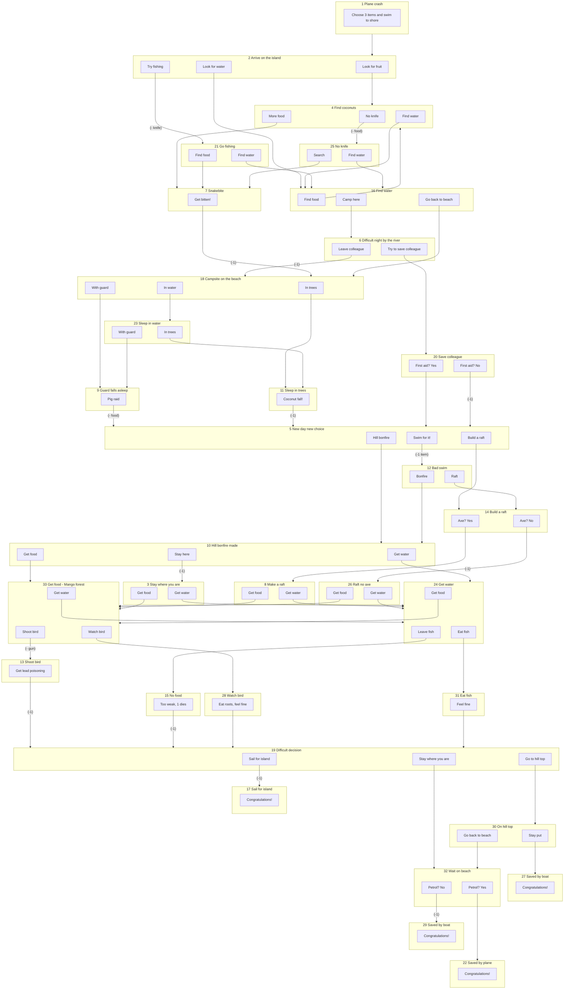

# Survivor: Teacher's notes

**Ressource**
: Document : [jeu SURVIVOR.pdf](Jeu Survivor PDF)

**Topic focus**
: Survival; The environment; Travel

**Grammar / Functional focus**
: Conditional structures (1^st^, 2^nd^ and 3^rd^ conditional);
: Future forms (going to and will); Agreeing and disagreeing

**Level / Number of students**
: Intermediate to Advanced / Minimum three students

**Time**
: 30-40 minutes (Extension 15 minutes)

## Preparation
Copy the introduction and Group discussion opposite (1 per group of 3-4 students), and the task cards (1 set per group). Cut up all sheets as indicated. Take in an image of a typical desert island to show the students during the lead-in.

### 1. Suggested lead-in
Write th efollowing questions on the board for discussion in pairs: *Who was Robinson Crusoe? Where did he live? How did he get there? What problems did he face? Can you think of any similar stories of people who lived on desert islands? Could you survive alone on a desert island?* Get feedback. Students will probably know recent films such as *Castaway* and *The Beach*.

### 2. Introduction: Choosing three items
Put the students into teams of three to four and hand out one copy of the introduction and card 1. Point out the key vocabulary beneath, which they can refer to later, and let them begin. Monitor. Even if there are two or four students in a team, make sure they understand that they have only three 'lives' per team on the island. If the team loses one or two members in the game, all the students in the class team can still take part in the decision making.

### 3. Continuing the "Decision Maze"
The teams will start to ask you for card 2. Make sure they have written down their three items on their introduction sheet. Remind them to discuss all the options carefully before making any decision, then give them the card. Some teams will decide more quickly than other cards. Some of the cards require them to cross items off their inventory as they use them (21 - knife; 12 - any one item; 13 - gun; 9 & 25 - food). All groups must go via three key cards: 2, 5, 19. On several cards, the groups lose one member of their team (6, 20, 7, 26, 3, 13, 15, 17, 29). Obviously, if they lose all three lives, they have failde. See the maze map for more details.

### 4. Finishing the maze
Teams will finish at different times, and with different levels of succes. To keep them busy if they finish early, get them to retrace their steps, and decide if and when they made any mstakes. They may want to try a different route!

## Extension: Group discussion
Once all the teams have finished, re-group them into groups of two to four, with students from other teams. Hand out the Group discussion sheet, and let them work through the questions, comparing their experiences on the island. For higher level classes, include questions 11 - 14 on the sheet, which include 3^rd^ conditional structures. For lower level classes, cut off the bottom part of the sheet as indicated. When all the groups have finished, get some general feedback, finding out how each team did. Some students might enjoy writing up an account of their adventure for homework. 

### Maze Map
This map show al the cards in the maze and how they link together to create a variety of possible ways to escape from the island.

### Key vocabulary
*axe*
: ~ a tool for cutting trees

*bullets*
: ~ the things you fire from a gun

*first aid kit*
: ~ important basic medical supplies

*bonfire*
: ~ a big fire (often to attract attention)

*mango*
: ~ a tropical tree with delicious fruit

*exhausted*
: ~ very, very tired

*raft*
: ~ a simple flat boat made from bits of wood

*lead (n) /led/
: ~ a metal, very poisonous

*fever*
: ~ serious illness with a very high temperature

*dehydration*
: ~ lack of water (illness)

*poisonous*
: ~ dangerous to eat or touch: can kill

*antibiotics*
: ~ medicine for serious infections

*split up*
: ~ divide / go off in different directions

*stream*
: ~ small river

*container*
: ~ e.G. bottle or box

*shore*
: ~ beach

*guard / keep guard*
: ~ look out for danger

### Group discussion

***After you have finished the Survivor task, discuss the following questions with students from other teams:***

1. Did you survive? How many of your team got away from the island? How did you get away?
2. What three things did you choose to take to the island from the plane? Why? Were they all useful?
3. If you did it again, would you choose the same things? Why (not)?
4. When you got to the beach, did you look for fruit, go fishing or look for water? What happened?
5. If you were on a real desert island, what else would you do after arriving on the island? Why?
6. On the second day, did you decide to build a raft or build a bonfire? Did it come in useful?
7. Did you come across any animals (e.g. a dead fish, a forest pig, a snake, a bird)? What happened?
8. If you really were trapped on a desert island, how would you try to find food?
9. If you had to live on a desert island for a year...
: a) what book would you take with you?
: b) what CD would you take with you?
: c) what food would you take with you?
: d) what famous person would you take with you?
10. What would you have done if you had met natives on the island?
11. How useful would these things have been on the island?
: a) a fishing-line and hook
: b) a mobile phone
: c) a mirror
: d) a botanist
: e) access to the internet
12. Could you have eaten insects or worms if you had been really hungry?
13. There have been many books written and films made about survival on a desert island. Why do you think this theme is so popular? Do you think the reality would really be like the fiction?# Survivor
